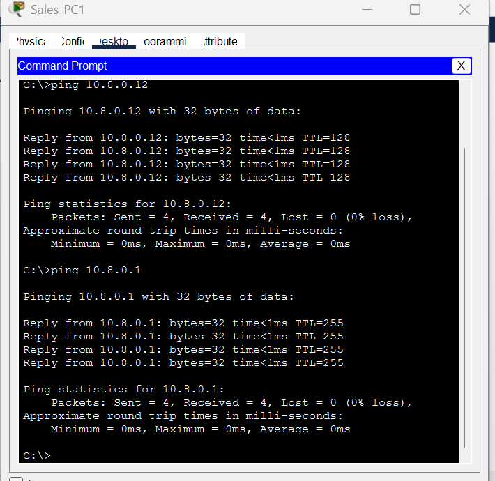
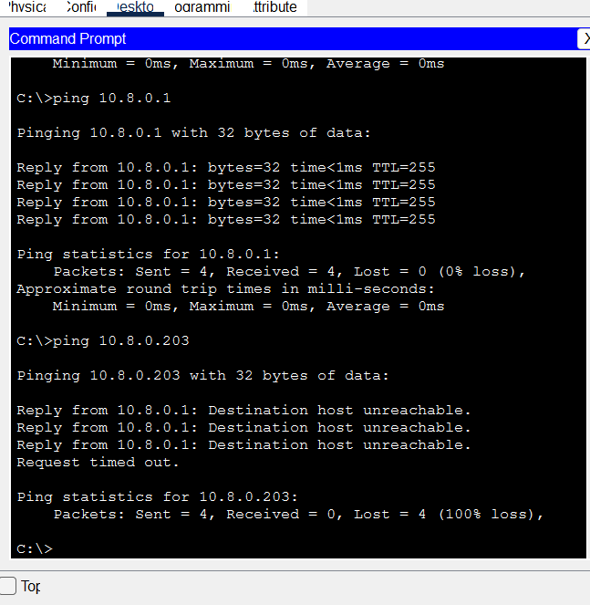
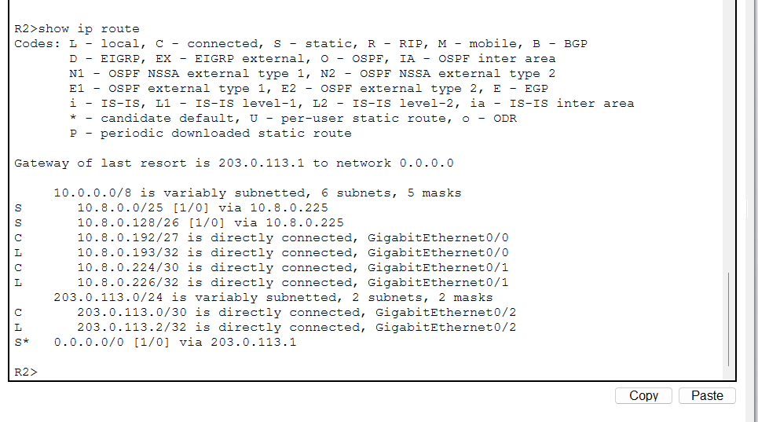
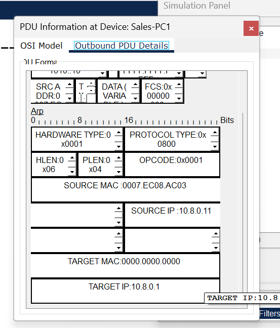
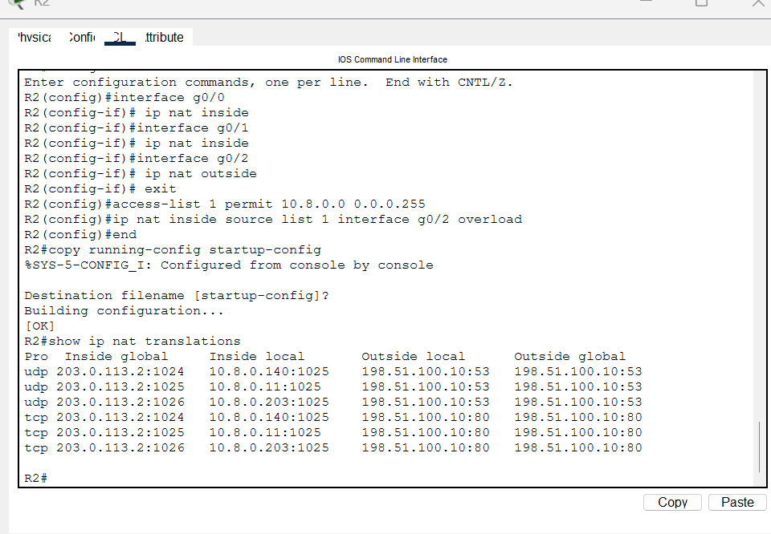
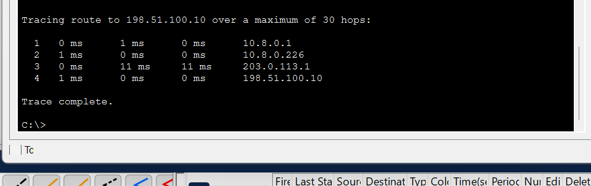

# Packet Tracer Lab: VLSM Subnetting, DHCP, Static Routing, and NAT/PAT

A Cisco Packet Tracer network built for a graduate networking course (John Jay College, M.S. Digital Forensics & Cybersecurity). It subnets a /24 block with VLSM, hands out addresses with DHCP, connects three LANs with static routing, and gives them Internet access through NAT overload. Verification output is in the evidence section.

**Skills shown:** VLSM subnet design, Cisco IOS configuration (interfaces, DHCP pools, static and default routes, ACLs, NAT/PAT), ARP and ICMP behavior, and troubleshooting with `ping`, `tracert`, `show ip route`, and `show ip nat translations`.

> Group course lab. Only the network design, configuration, and verification output are published here.

---

## Topology

```
 Sales LAN (100 hosts)        Engineering LAN (50)
   10.8.0.0/25                 10.8.0.128/26
        \                         /
         G0/0               G0/1
              [ R1 ]--G0/2
                       |  10.8.0.224/30
                     G0/1
 Management LAN (20) -- G0/0 [ R2 ] G0/2 -- 203.0.113.0/30 -- [ ISP ] -- 198.51.100.0/24 -- Web/DNS server
   10.8.0.192/27                  (NAT)
```

Three LANs (Sales and Engineering behind R1, Management behind R2). R2 connects to an ISP router, and the ISP connects to a web/DNS server.

## Addressing plan (VLSM, largest subnet first)

| Network | Hosts needed | Subnet | Mask | Usable range | Broadcast | Router address |
|---|---|---|---|---|---|---|
| Sales | 100 | 10.8.0.0/25 | 255.255.255.128 | .1 – .126 | 10.8.0.127 | R1 G0/0: 10.8.0.1 |
| Engineering | 50 | 10.8.0.128/26 | 255.255.255.192 | .129 – .190 | 10.8.0.191 | R1 G0/1: 10.8.0.129 |
| Management | 20 | 10.8.0.192/27 | 255.255.255.224 | .193 – .222 | 10.8.0.223 | R2 G0/0: 10.8.0.193 |
| R1–R2 link | 2 | 10.8.0.224/30 | 255.255.255.252 | .225 – .226 | 10.8.0.227 | R1 .225 / R2 .226 |
| R2–ISP link | given | 203.0.113.0/30 | 255.255.255.252 | .1 – .2 | 203.0.113.3 | ISP .1 / R2 .2 |
| Server network | given | 198.51.100.0/24 | 255.255.255.0 | | | ISP .1 / Server .10 |

Placing the largest subnet first keeps every network address on a multiple of its block size and leaves no wasted gaps. A /30 is the smallest subnet with two usable addresses, so it fits the point-to-point router link exactly.

## Configuration

**R1**

```
hostname R1
interface g0/0
 ip address 10.8.0.1 255.255.255.128
 no shutdown
interface g0/1
 ip address 10.8.0.129 255.255.255.192
 no shutdown
interface g0/2
 ip address 10.8.0.225 255.255.255.252
 no shutdown
ip dhcp excluded-address 10.8.0.1 10.8.0.10
ip dhcp excluded-address 10.8.0.129 10.8.0.138
ip dhcp pool SALES
 network 10.8.0.0 255.255.255.128
 default-router 10.8.0.1
 dns-server 198.51.100.10
ip dhcp pool ENG
 network 10.8.0.128 255.255.255.192
 default-router 10.8.0.129
 dns-server 198.51.100.10
ip route 0.0.0.0 0.0.0.0 10.8.0.226
```

**R2**

```
hostname R2
interface g0/0
 ip address 10.8.0.193 255.255.255.224
 ip nat inside
interface g0/1
 ip address 10.8.0.226 255.255.255.252
 ip nat inside
interface g0/2
 ip address 203.0.113.2 255.255.255.252
 ip nat outside
ip dhcp excluded-address 10.8.0.193 10.8.0.202
ip dhcp pool MGMT
 network 10.8.0.192 255.255.255.224
 default-router 10.8.0.193
 dns-server 198.51.100.10
ip route 10.8.0.0 255.255.255.128 10.8.0.225
ip route 10.8.0.128 255.255.255.192 10.8.0.225
ip route 0.0.0.0 0.0.0.0 203.0.113.1
access-list 1 permit 10.8.0.0 0.0.0.255
ip nat inside source list 1 interface g0/2 overload
```

**ISP and server:** ISP G0/0 = 203.0.113.1/30, G0/1 = 198.51.100.1/24. Server = 198.51.100.10/24, gateway 198.51.100.1, running DNS (`www.netlab.test` → 198.51.100.10) and HTTP.

## What I built and tested

1. **Addressing and DHCP:** each LAN gets its address, gateway, and DNS server from a router-hosted DHCP pool, with the first 10 addresses of each LAN excluded for infrastructure and static devices.
2. **Failure before static routing:** a ping from Sales to Management failed because R1 only knew its directly connected networks. The "Destination host unreachable" reply came from R1 itself, which identified where the packet was dropped.
3. **Static routing:** R2 learned the Sales and Engineering subnets through static routes, and both routers use a default route toward the ISP. R2's route table shows connected (C), local (L), static (S), and default (S*) entries.
4. **Failure before NAT:** a ping to the server timed out instead of returning "unreachable." The request reached the server, but the ISP had no route back to the private 10.8.0.0/24 range.
5. **NAT/PAT:** overload on R2 translates all three LANs to its single public address (203.0.113.2), separating connections by port number. The web page then loads through DNS and HTTP.
6. **Packet-level view:** in Simulation mode, the Sales PC first sends an ARP request for its default gateway (not the destination host) because the destination is on a different subnet.

## Evidence

Terminal output and Packet Tracer captures from the lab.

**Same-LAN and gateway ping (TTL 128 for a PC, 255 for a Cisco router)**



**Ping to Management before static routing: "Destination host unreachable" from R1**



**R2 routing table: connected, local, static, and default routes**



**ARP request from Sales-PC1 for its default gateway (Simulation mode)**



**NAT configuration and translation table (PAT: one public IP, distinct ports)**



**Traceroute from a Sales PC to the server: R1, R2, ISP, server**



## Tools

Cisco Packet Tracer 9.0, Cisco IOS CLI, Windows command prompt (`ping`, `tracert`).
